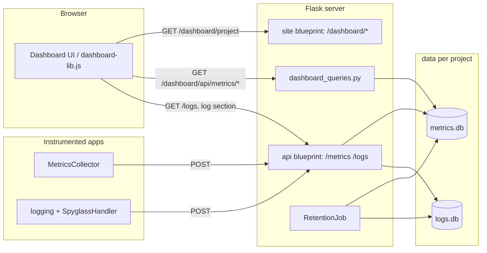

# Spyglass

[](https://github.com/momonala/spyglass/actions/workflows/ci.yml)

Metrics and log collection for small Python services, with a hosted dashboard UI. Apps emit data through a client SDK; a Flask server ingests it into per-project SQLite files and serves a dashboard at `/dashboard/{project}`.

**Last updated:** 2026-07-27

## What this solves

- A **Python SDK** that sends metrics and logs over HTTP (fire-and-forget; failures do not break your app).
- A **single Flask server** that ingests data, stores it, and serves a dashboard UI per project.
- **Filesystem isolation** per project: `data/{project-slug}/metrics.db`, `logs.db`, `settings.json`, `dashboard.json`.

## Prerequisites

- Python 3.12+
- [uv](https://github.com/astral-sh/uv)
- Node.js (only to run the dashboard JS tests, `tests/*.mjs`)

## Configuration

Non-secret settings live in `pyproject.toml` under `[tool.config]`, loaded by `spyglass._config.CONFIG`:

```toml
[tool.config]
data_dir = "data"       # root for per-project DB directories
host = "0.0.0.0"
port = 5013
retention_days = 30     # default; overridable per project at registration
```

Secrets go in `.env` (loaded via `python-dotenv` in `src/env.py`):

```bash
cp .env.example .env
```

```python
from src.env import TELEGRAM_API_TOKEN
```

Runtime data under `data/` is gitignored.

Legacy template CLI (project metadata from `pyproject.toml`, unrelated to the dashboard):

```bash
uv run spyglass-config --project-name
uv run spyglass-config --all
```

## Quick start

Run **one Spyglass server** on your machine. Point **each app** at it with a distinct `project` name (that becomes `data/{project-slug}/` on disk).

### 1. Install and start the server (this repo)

Clone once and install the CLI as a uv tool so `spyglass` is available globally:

```bash
git clone <your-spyglass-repo-url> ~/code/spyglass
cd ~/code/spyglass
uv sync
uv tool install --editable .
spyglass --port 5013
```

Leave this running — all instrumented apps send to `http://localhost:5013`. To upgrade after pulling changes: `cd ~/code/spyglass && git pull && uv sync && uv tool install --editable --force .`

Open `http://localhost:5013/dashboard/` — one card per registered project showing row counts, 24h error count, a 48-hour write-rate sparkline, on-disk size and retention. The index deliberately stays quiet when everything is fine: the error count turns red when non-zero and the last-activity age turns amber once a project has written nothing for 24h, so there's no separate "healthy" indicator (one that's green on every card carries no information).

### 2. Add the SDK to each application project

In every repo you want to instrument (repeat per project):

```bash
cd ~/code/my-api
uv add --editable ~/code/spyglass
uv sync
```

Or as a git dependency (see `[tool.uv.sources]` in any consumer repo, e.g. `energy-monitor`, `trainspotter`, `incognita`):

```toml
[project]
dependencies = ["spyglass"]

[tool.uv.sources]
spyglass = { git = "https://github.com/momonala/spyglass.git", rev = "main" }
```

### 3. Instrument each app with a unique `project`

```python
from spyglass import initialize

logger, metrics = initialize(host="localhost:5013", project="my-api")

def handle_request():
    metrics.increment("requests")   # → my-api.handle_request.requests
    metrics.gauge("queue_depth", 3)
    with metrics.timed("db_query"):
        ...
    logger.info("handled request")
```

| Application repo | `project=` value | Data on server |
|------------------|------------------|----------------|
| `~/code/my-api` | `"my-api"` | `data/my-api/` |
| `~/code/worker` | `"worker"` | `data/worker/` |

### 4. Verify

```bash
curl http://localhost:5013/status
curl "http://localhost:5013/metrics?project=my-api&limit=5"
curl "http://localhost:5013/logs?project=my-api&level=INFO"
```

### Notes

- **Server vs SDK:** `uv tool install` is only for the machine-wide `spyglass` server command. App repos add the SDK as a normal (or editable/git) dependency for imports only; they do not run the server themselves.
- **Path dependency:** If you move the spyglass clone, re-run `uv add --editable <new-path>` in each app (or update `[tool.uv.sources]`).

## Project structure

```
spyglass/
├── pyproject.toml
├── alembic.ini
├── alembic/versions/            # metrics + logs schema migrations (two independent branches)
├── src/
│   ├── spyglass/
│   │   ├── __init__.py          # public exports: initialize, MetricsCollector, configure_logging
│   │   ├── cli.py               # `spyglass` server entrypoint
│   │   ├── _config.py           # loads [tool.config]
│   │   ├── config.py            # legacy Typer config CLI (`uv run spyglass-config`)
│   │   ├── client/
│   │   │   ├── collector.py     # MetricsCollector (metrics SDK)
│   │   │   ├── logging.py       # SpyglassHandler + configure_logging
│   │   │   ├── initialize.py    # initialize() — logger + MetricsCollector in one call
│   │   │   └── query.py         # SpyglassQueryClient — low-level HTTP fetch, unused by hosted dashboards
│   │   ├── dashboard/           # legacy aggregation library — unused by hosted dashboards, see below
│   │   │   ├── aggregate.py     # TimeWindow, counter_series, timing_*, etc.
│   │   │   ├── builder.py       # SummaryBuilder
│   │   │   ├── config.py        # MetricSelector, ChartDefinition, StateTransitionRule
│   │   │   └── schemas.py       # SummaryResponse and related types
│   │   ├── server/
│   │   │   ├── app.py           # Flask factory; registers api + site blueprints
│   │   │   ├── routes.py        # ingest/query API blueprint (/metrics, /logs, /projects/register)
│   │   │   ├── site.py          # dashboard UI blueprint (/dashboard/*)
│   │   │   ├── dashboard_queries.py  # SQLAlchemy aggregation backing the dashboard JSON API
│   │   │   ├── util.py          # timestamp parsing helpers
│   │   │   └── retention.py     # schedule + background thread
│   │   ├── db/
│   │   │   ├── models.py        # MetricPoint, LogEntry (timestamp PK)
│   │   │   └── store.py         # per-project SQLite routing + lazy alembic migration
│   │   ├── templates/dashboard/
│   │   │   ├── _base.html       # shared shell: header controls, log section
│   │   │   ├── _sidebar.html    # project rail, included by _base and index
│   │   │   ├── index.html       # /dashboard/ project overview cards
│   │   │   ├── energy-monitor.html
│   │   │   ├── trainspotter.html
│   │   │   ├── incognita.html
│   │   │   ├── find-my.html
│   │   │   └── claude-usage-notch-server.html
│   │   └── static/dashboard/
│   │       ├── css/{shared,components}.css
│   │       ├── js/sidebar.js        # collapse toggle, state in localStorage
│   │       └── js/dashboard-lib.js  # chart builders, stat fillers, log section, initDashboard()
│   └── env.py                   # .env secrets
├── docs/                        # per-project dashboard change logs (e.g. trainspotter-dashboard-handoff.md)
├── tests/                       # pytest (Python) + tests/*.mjs (dashboard-lib.js, run with `node --test`)
└── data/                        # created at runtime (not in git)
    └── {project-slug}/
        ├── metrics.db
        ├── logs.db
        ├── settings.json        # per-project retention_days
        └── dashboard.json       # optional saved widget layout (see Dashboard API)
```

## Architecture



**Boundaries:** `spyglass.client` never touches SQLAlchemy. `spyglass.server.routes` (ingest/query API) and `spyglass.server.site` (dashboard UI + JSON API) both route by `project` through `db.store.ProjectStore`, which lazily creates and migrates each project's `metrics.db`/`logs.db` on first access. Retention runs in a daemon thread using `schedule` (daily at `RETENTION_TIME` in `retention.py`, plus once at startup).

**Stat naming:** With default `prefix=True`, `increment("requests")` inside `handle_request` becomes `{project}.handle_request.requests`. Use `prefix=False` to send a full stat name unchanged (used e.g. by decorators that would otherwise report their own wrapper function's name as the caller).

## Client SDK

| Component | Role |
|-----------|------|
| `initialize(host, project, ...)` | Returns `(logger, MetricsCollector)`; logger name matches caller's `__name__` |
| `MetricsCollector(host, project, ...)` | `increment`, `decrement`, `gauge`, `timing`, `set`, `timed()` context manager |
| `configure_logging(host, project, ...)` | `basicConfig` to stdout + remote `SpyglassHandler` (used by `initialize`) |

`project` must be a non-empty string; there is no auto-discovery from `pyproject.toml`.

Network errors are logged and swallowed so instrumentation never raises into application code.

## HTTP API

Base URL: `http://{host}:{port}` (default `5013`).

| Endpoint | Method | Description |
|----------|--------|-------------|
| `/status` | GET | Liveness |
| `/projects/register` | POST | Register project + `retention_days` |
| `/metrics` | POST | Ingest metric point(s) |
| `/logs` | POST | Ingest log entry/entries |
| `/metrics` | GET | Query metrics (`project` required) |
| `/logs` | GET | Query logs (`project` required) |

GET query params: `name` (prefix), `metric_type`, `from`, `to`, `limit`. Logs support `level`, `from`, `to`, `limit`.

```bash
curl -X POST http://localhost:5013/projects/register \
  -H "Content-Type: application/json" \
  -d '{"project": "my-api", "retention_days": 30}'

curl -X POST http://localhost:5013/metrics \
  -H "Content-Type: application/json" \
  -d '{"project": "my-api", "name": "my-api.handle_request.requests", "metric_type": "counter", "value": 1}'

curl "http://localhost:5013/metrics?project=my-api&metric_type=counter&limit=100"
```

### Dashboard API (`spyglass.server.site`)

Backs the hosted dashboard UI; also usable directly.

| Endpoint | Method | Description |
|----------|--------|-------------|
| `/dashboard/` | GET | Project index |
| `/dashboard/{project}` | GET | Renders `templates/dashboard/{project}.html`, 404 if no template exists |
| `/dashboard/api/projects` | GET | List registered project slugs + display names |
| `/dashboard/api/metrics/names` | GET | Distinct metric names + types for a project |
| `/dashboard/api/metrics/series` | GET | Bucketed time series for one metric (`name`, `from`, `to`, `interval` seconds, `tag_{key}={value}`) |
| `/dashboard/api/metrics/summary` | GET | `latest_value`, `sum`, `min`, `avg`, `max`, and `count`/`p50`/`p95` for timings, over a window |
| `/dashboard/api/metrics/tag-values` | GET | Distinct tag values for a metric + tag key |
| `/dashboard/api/metrics/histogram` | GET | Equal-width histogram bins for a metric over a window |
| `/dashboard/api/metrics/histogram-multi` | GET | Equal-width histogram bins across multiple metrics (repeated `name`) over a window |
| `/dashboard/api/layout` | GET/PUT | Load/save a per-project widget layout (`data/{slug}/dashboard.json`) — not currently used by any shipped dashboard template, which hardcode their own sections instead |

`GET /` redirects to `/dashboard/`.

## Dashboards

Adding a dashboard for a new project means dropping a template file — no Python changes:

1. Create `src/spyglass/templates/dashboard/{project}.html`, extending `_base.html`:
   ```jinja
   
   {project}
   ...
   <script>...</script>
   ```
2. In ``, call `initDashboard({ project, loadFn, defaultWindowAmount, defaultWindowUnit, defaultRollupMinutes })` from `static/dashboard/js/dashboard-lib.js`. `loadFn(win, signal)` fires on load, on control changes, and every 30s.
3. Build sections with the shared helpers, all reading from the Dashboard API above: `buildLineChart`, `buildBarChart`, `buildStackedBarChart` (Chart.js canvases), `fillStats`, `fillDerivedStat` (stat elements by id).
4. Reuse existing CSS classes from `static/dashboard/css/{shared,components}.css` — `.card`, `.card-full`, `.stat-grid`, `.chart-card`, `.chart-card--inset`, `.ts-top-row`, `.em-stat-row` — rather than adding new ones. Write label text in sentence case; no stylesheet uppercases it for you, and nothing in the UI is set in all caps except log levels, which arrive capitalised as data.

`_base.html` provides the sidebar via `_sidebar.html` (auto-populated from every `templates/dashboard/*.html` except partials/`index`), time-window controls, and the full log section (histogram, filterable table, traceback rendering, pattern grouping) — none of that is per-project.

Reference dashboards: `energy-monitor.html`, `trainspotter.html`, `incognita.html`, `find-my.html`, `claude-usage-notch-server.html`. `docs/*-dashboard-handoff.md` record metric-naming changes behind an existing dashboard (e.g. a metric rename or removal) — not build instructions.

### Legacy aggregation library

`spyglass.client.query.SpyglassQueryClient` and `spyglass.dashboard.*` (`SummaryBuilder`, `aggregate.py` functions) are a lower-level, server-side aggregation path: fetch raw points over HTTP, aggregate in the consumer app's own Python process, render your own view. No current dashboard (`energy-monitor`, `trainspotter`, `incognita`, `find-my`, `claude-usage-notch-server`) uses this — all use the hosted `/dashboard/{project}` system above. Still present and tested (`tests/test_dashboard.py`) for cases where a consumer app wants to embed aggregated data in its own UI instead of using the hosted one.

## Data model

Both tables use an autoincrement `id` surrogate primary key, with `timestamp` (UTC, naive in SQLite) indexed separately — migration `0001`/`0002` moved both tables off `timestamp`-as-PK to allow duplicate timestamps. Schema is managed by alembic (`alembic/versions/`, two independent branches: `metrics`, `logs`), applied lazily per project database on first access.

**`metric_points`** (`metrics.db`): `id`, `timestamp`, `name`, `metric_type` (see `MetricType` in `spyglass.db.models`), `value`, `tags` (JSON text).

**`log_entries`** (`logs.db`): `id`, `timestamp`, `level`, `logger_name`, `message`, `extra` (JSON text).

Retention deletes rows older than each project's `retention_days` (from `data/{slug}/settings.json`), scanning all project directories once a day (`RETENTION_TIME` in `retention.py`) and once at startup.

## Development

```bash
uv sync
uv run --with pytest --with pytest-cov pytest                              # Python tests + coverage (see pyproject.toml addopts)
uvx black . --check                     # formatting
uvx ruff check .                        # linting
node --test tests/*.mjs                    # dashboard-lib.js tests (not currently wired into CI)
```
